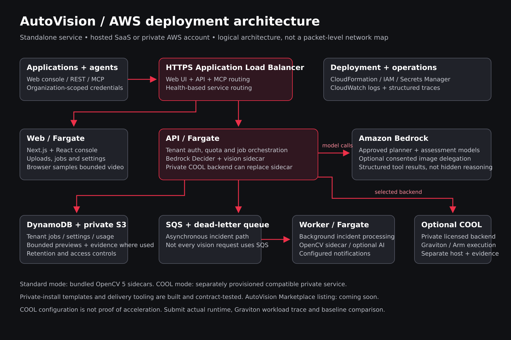
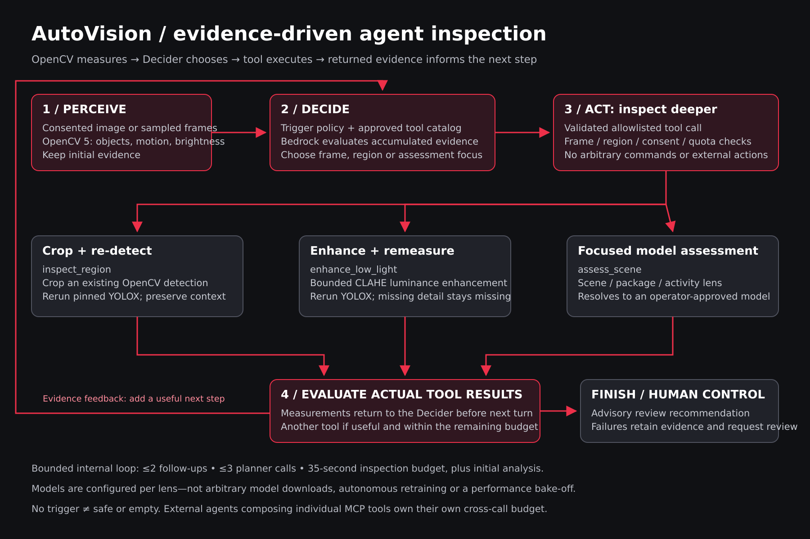

```text
  A   U   U TTTTT  OOO  V   V IIIII  SSSS IIIII  OOO  N   N
 A A  U   U   T   O   O V   V   I   S       I   O   O NN  N
AAAAA U   U   T   O   O V   V   I    SSS    I   O   O N N N
A   A U   U   T   O   O  V V    I       S   I   O   O N  NN
A   A  UUU    T    OOO    V   IIIII SSSS  IIIII  OOO  N   N

GIVE YOUR APPLICATION A PAIR OF EYES.
```

# AutoVision

[](https://github.com/techcto/autovision/actions/workflows/ci.yml)
[](https://github.com/techcto/autovision)

AutoVision is an open-source, standalone visual-analysis service for applications, camera adapters, and AI agents. OpenCV 5 measures images and sampled video; an opt-in Amazon Bedrock planner can decide to look deeper, execute bounded vision tools, and use their returned evidence to choose another tool or recommend human review. REST, MCP, the web console, SaaS, and private AWS installations share the same analysis pipeline.

## Judges: start here





Download submission-ready diagrams: [AWS stack PNG](public/aws-stack.png) · [Agent flow PNG](public/agent-flow.png). Editable SVGs and the reproducible renderer are in `public/` and `devops/testing/export-architecture-diagrams.mjs`.

**Console walkthrough:** [Browse the final screenshot gallery](docs/console-gallery-final/index.html) · [captions and capture notes](docs/console-gallery-final/README.md). These show an actual signed-in local video analysis, job evidence, OpenCV settings and enhanced-inspection controls. Local Bedrock was not configured during capture; the screenshots do not claim a new successful AI loop.

**[Judge's field guide and technical report](docs/JUDGES_FIELD_GUIDE.md)** · **[Agent workflow](docs/JUDGES_FIELD_GUIDE.md#the-perception-decision-action-loop)** · **[Recorded live trace](devops/testing/autonomous-inspection-live.json)** · **[Inspection contract](AUTONOMOUS_INSPECTION.md)**

The key demonstration is not a chatbot explaining a fixed detection. **OpenCV evidence changes what the agent does next:** crop and re-detect an existing object, enhance a dark frame and remeasure it, or call a focused scene/package/activity assessment using a deployment-approved model. Actual tool results return to the planner before its next decision. The final action is an advisory review recommendation, not an autonomous security decision.

**Featured MCP demo:** [Give your favorite agent vision](docs/JUDGES_FIELD_GUIDE.md#featured-demo-give-your-favorite-agent-vision-through-mcp). Connect `https://autovision.dev/mcp` using Streamable HTTP and an organization API key, discover the lenses, and ask the agent to inspect an authorized image. The guide includes connection fields, a ready-to-use prompt, file/base64 requirements, and the distinction between AutoVision's bounded Decider and an external agent composing individual tools.

AutoVision stands alone. [SmartDetector](https://github.com/techcto/smartdetector) demonstrates a consuming application that supplies authorized camera samples and presents returned observations; Ring account linking and Fire TV presentation belong to SmartDetector, not the AutoVision service.

### Special-award paths

**Primary: Agentic Vision. Additional: Best Use of COOL.** Private AWS templates support `VisionBackend=cool` and `CoolVisionUrl` to route vision calls to a separately provisioned, licensed COOL service on AWS Graviton instead of the standard sidecars. This deployment option is implemented; it is not itself proof that COOL executed the workload or improved performance. See the [COOL evidence checklist](docs/JUDGES_FIELD_GUIDE.md#additional-award-path-cool-on-private-aws) and [backend configuration](devops/cloudformation/README.md#optional-cool-backend). Submit the actual COOL/Arm runtime evidence and reproducible baseline comparison for that award. The hosted standard backend must not be presented as COOL.

[Website](https://autovision.dev) · [Source](https://github.com/techcto/autovision) · [Deployment guide](devops/cloudformation/README.md)

<a href="https://autovision.dev"></a>
**AWS Marketplace: coming soon.** The AutoVision listing is not yet live; no subscription link is enabled.
<a href="https://console.aws.amazon.com/cloudformation/home?region=us-east-1#/stacks/create/review?templateURL=https://autovision-api.s3.us-east-1.amazonaws.com/cloudformation/autovision.yaml&amp;stackName=autovision"></a>

## The Problem

Camera feeds produce far more footage than a person can continuously inspect. Applications need a small, predictable API that can turn image changes into structured observations without becoming a camera vendor or rebuilding a vision pipeline. AutoVision starts with a bounded, reproducible primitive: compare two images and return motion observations.

## Hackathon Pitch — OpenCV AI Competition 2026

**Give your application a pair of eyes.** AutoVision turns images and short clips into measurable visual signals: motion across time, OpenCV object detections (people, pets, vehicles and other COCO categories), and optional Nova Lite scene descriptions and package locations. Developers can use the same analysis through an interactive demo, REST API, or MCP tool instead of rebuilding a vision service for every application.

AutoVision is being prepared for the [OpenCV AI Competition 2026, powered by AWS](https://opencv26.devpost.com/). OpenCV performs the actual image processing; AWS supplies the deployment platform and optional Bedrock inference. The intended demonstration combines a camera-style clip, explainable results, private job history, and an agent consuming the same tools.

The service uses **OpenCV 5.0.0** end to end: image decoding, resizing, grayscale conversion, frame differencing, thresholding, changed-pixel measurements, JPEG previews and object detection. A pinned, checksum-verified [OpenCV Zoo YOLOX](https://github.com/opencv/opencv_zoo/tree/47534e27c9851bb1128ccc0102f1145e27f23f98/models/object_detection_yolox) model (Apache-2.0) runs in-process through `cv2.dnn` and detects people plus the requested COCO-80 categories on every sampled frame. Nova Lite supplies optional scene summaries and advisory package, smoke and fire boxes. REST and MCP share this pipeline.

### Technical report and reproducible evaluation

AutoVision serves developers adding visual observations to camera, workflow and agent applications. Browser sampling keeps original video/audio local and sends bounded image samples. New jobs retain small sampled previews and structured observations for seven days, not the original clip. Settings includes organization-specific AI categories and a confirmed history purge; see [object detection and privacy](OBJECT_DETECTION.md). See the [architecture diagram](public/architecture.svg) and [editable source](devops/testing/architecture.mmd).

The synthetic evaluation uses five repetitions per two-frame 320×180 sequence. On local x86-64 Docker on October 13, 2026, measured changed-pixel fractions exactly matched generated masks: 0%, 5%, 50% and 100%, with median two-frame analysis latencies of 77–79 ms (the retired HOG subprocess path measured 448–483 ms on October 9). These are machine-specific measurements, not throughput guarantees or real-world detector accuracy.

The detector evaluation samples the four demo clips and a freely licensed [samplelib street clip](https://download.samplelib.com/mp4/sample-20s.mp4) exactly like the browser (56 frames) and compares YOLOX with a recorded OpenCV 4.13 HOG historical baseline ([`hog_baseline.json`](devops/testing/hog_baseline.json), produced by [`hog-baseline.py`](devops/testing/hog-baseline.py); all 56 frames byte-identical). YOLOX found the person in 11/11 backyard, 10/11 doorbell and 11/11 delivery frames, where HOG found 4, 4 and 8, and found the dog in 8/11 night frames, which HOG cannot detect. On that x86-64 machine YOLOX took 38 ms median and 40 ms p95 per 640-pixel frame versus 7.5 ms for HOG. Fargate measurements are pending. There is no hand-labelled ground truth, so these are presence counts, not precision or recall.

The lighting-change case documents a failure mode: brightness shifts trigger motion without proving an intruder. Observed YOLOX failures: a person's shadow on a fence counted as a second person, the night dog scored as a person (0.63) on one Live Lab frame, a ball labelled frisbee, a dog labelled horse in one frame, and a cardboard parcel labelled suitcase (package stays with Bedrock grounding). Detector scores are not calibrated probabilities. Nova grounding is advisory, not a calibrated probability; sampled frames can miss events. Smoke/fire require separate validation and cannot replace certified alarms. Embedded image instructions are untrusted.

Reproduce with `docker compose run --rm --no-deps -v "$PWD/public:/app/public:ro" autovision-vision python -m unittest discover -s src/vision -v` (detector tests read the demo poster from `public/`) and `docker compose run --rm --no-deps autovision-vision python src/vision/evaluate.py`. For the detector evaluation, also mount `-v "$PWD/public:/media:ro" -v "$PWD/devops/testing:/app/devops/testing:ro"` (the dev-only HOG baseline is not in the image) and pass clip paths such as `/media/intruder.mp4` after `evaluate.py`. Run `npm run test:mcp:local`; add `AUTOVISION_TEST_BEDROCK=true` when dedicated local credentials are configured.

Submission packaging includes the submitted revision, setup, report with representative-media evaluation, exported architecture, judge access and a public/unlisted video no longer than five minutes. Single-call classification does not establish the optional Agentic Vision award; COOL acceleration is not claimed. Follow the [requirements](https://opencv26.devpost.com/) and [rules](https://opencv26.devpost.com/rules). The page displays conflicting October 26 cutoff times; use the earlier 11:45 PM Pacific cutoff unless clarified.

## Try AutoVision

For the latest development demo, start the local stack below and open [localhost:8081](http://localhost:8081). Upload an image or short video for live analysis, or browse the supplied dog, doorbell visitor, package and backyard visitor clips with cached results. Illustrated animations and synthetic-run buttons have been removed from the public site and console; generated fixtures remain only in automated tests and technical benchmarks. Enable Bedrock for scene summaries and advisory boxes when configured. See the local [API reference](http://localhost:8081/api-reference) and [MCP guide](http://localhost:8081/docs/mcp).

The homepage doorbell demo silently loops the supplied `public/intruder.mp4` without video-player controls. Click **View analysis** below it, then sample thumbnails or Previous/Next to inspect each image and its actual returned boxes. **Back to video** returns to the loop. Green boxes are OpenCV output; dashed red boxes are advisory Bedrock grounding. Video overlays appear only within 250 ms of a sampled timestamp, not as a continuous object tracker. The file name does not establish intent, identity, or danger. This recording is cached as a public asset: page visits and sample navigation do not call inference.

To regenerate the public demo recording against a configured localhost stack, run `node devops/testing/record-home-demo.cjs` with Playwright/Chromium available. This uses the Live Lab browser sampler and analysis endpoint, requires successful AI grounding and real returned boxes, and writes `public/demo/intruder-analysis.json` plus a poster. The JSON records the source SHA-256, timestamps, engine versions and model. Run `node devops/testing/home-demo.cjs` to check playback, all samples/boxes, navigation, responsive layout, and absence of per-visit inference calls. Only use footage authorized for public distribution; this bundled demo is intentionally public, unlike private customer uploads.

The hosted site is [autovision.dev](https://autovision.dev); its deployment may lag the local build. Sign in with an account supplied by the deployment owner. Hosted launch credentials are private and are **not** the local development defaults. In SaaS mode, signup creates a personal workspace; private installations disable public signup and billing.

1. Open Settings and create an API key. Copy it when shown; only its hash is stored.
2. Send the synthetic image-pair request in the API section below.
3. Inspect the returned motion observations and usage.
4. Use **Run smoke sensor simulation** to explore the separate device-to-incident workflow.

The current hosted stack, `autovision-apphub-v011`, runs on the shared AppHub Fargate platform. The standalone CloudFormation template remains available for private installations. The stack-name suffix is historical; it is not a statement of the running release version.

## Core Capabilities

- Organization-scoped devices, observations, incidents, users, and settings.
- Deterministic demonstration rules for smoke, temperature, and CO readings; motion and person signals are also accepted.
- Asynchronous incident processing with optional Bedrock enrichment and configured SES email delivery.
- Bearer API keys revealed once at creation and stored as hashes.
- OpenCV 5 motion measurements and YOLOX object boxes (person plus selected COCO-80 categories) for images and up to 12 sampled video frames.
- Optional Nova Lite summaries and advisory package boxes on the first, middle, and last supplied frames.
- REST and MCP analysis with shared API keys; session-authorized manual runs and private seven-day job history.
- SaaS and private-install modes using the same application images.
- Stripe Checkout and signed webhook integration, activated only after keys and price IDs are configured.

## Turnkey Platform

| Layer | Included capability |
| --- | --- |
| Web | Next.js/React console, workspace selection, devices, incidents, users, settings |
| API | Next.js route handlers under `src/app/api`, authentication, tenant-scoped operations |
| Worker | SQS incident processing, optional Bedrock assessment, configured email notification |
| Vision | OpenCV 5 motion and YOLOX COCO-80 detection plus optional Nova Lite package, smoke and fire grounding |
| Persistence | DynamoDB job results/thumbnails, private evidence S3, SQS and a dead-letter queue; original demo videos are not stored |
| Local runtime | Root Docker Compose, Dockerfiles in `devops`, DynamoDB Local and ElasticMQ |
| AWS runtime | ECS Fargate, ALB, IAM, CloudWatch, optional ACM HTTPS and Route 53 aliases |
| Delivery | GitHub Actions, versioned containers, S3 CloudFormation assets, Marketplace changesets |

AutoVision has web, API, worker, and vision images. The AWS worker task includes the vision sidecar.

## Local Development

Prerequisite: Docker with Compose. Use the wrapper to create the shared local network before starting the containers:

```bash
git clone https://github.com/techcto/autovision.git
cd autovision
cp .env.example .env
bash app.sh up
```

Open [http://localhost:8081](http://localhost:8081). Local username: `root`; local password: `autovision-local-change-me`. Change `AUTOVISION_ROOT_PASSWORD` and `AUTOVISION_SESSION_SECRET` before exposing the app outside your development machine. Local mode defaults to a private installation: a demo homepage and one root user, with signup and billing disabled. AWS launch parameters choose the deployed mode independently.

```bash
curl --fail http://localhost:8081/api/health
docker compose ps
bash app.sh logs
# Stop containers without deleting data volumes:
bash app.sh down
```

Compose builds the web, API, and worker, plus the vision service. DynamoDB Local and ElasticMQ replace the cloud database and queue locally. Data volumes survive container restarts and `docker compose down`; do not use `down -v` unless intentionally discarding local data. AWS notification sending and Bedrock require separate configuration; local startup does not prove those integrations are enabled.

For source checks, install the Node.js version declared in `package.json`, then run:

```bash
npm ci
npm run typecheck
npm run test:web
bash git.sh audit
```

## API Examples

The web entry point routes `/api/*` to the API service. Replace local URLs with `https://autovision.dev` for an authorized hosted request. Health is public; other endpoints require their documented credentials.

### Compare a synthetic image pair

Create an API key in Settings, then supply it as `AUTOVISION_API_KEY` in your shell:

```bash
curl --fail-with-body http://localhost:8081/api/v1/detect \
  -H "Authorization: Bearer $AUTOVISION_API_KEY" \
  -H 'Content-Type: application/json' \
  -d '{"demo":true}'
```

`demo:true` uses a synthetic pair. For real comparisons, send base64 image strings:

```json
{
  "image": "<base64-current-frame>",
  "previous_image": "<base64-previous-frame>"
}
```

The response contains motion observations. Requests require a valid organization-scoped key, are bounded to 4 MB at the API, and consume monthly quota. Free, Starter, and Scale quotas are 1,000, 10,000, and 100,000 comparisons/month. Private-install quota behavior differs from SaaS plans. Invalid keys return 401, exhausted quota returns 429, and an unavailable vision service returns 503. Arbitrary live video URLs are not accepted; a video adapter must sample frames and submit pairs.

## AWS Marketplace And Deployment

The AutoVision Marketplace listing is **not yet live**. Private-install templates, container delivery tooling, and deployment contract tests are built out. This is deployment readiness, not a claim that public Marketplace purchase or a new buyer's end-to-end installation has been verified. Images requiring entitlement remain subject to authorized access. The **LAUNCH AWS** button opens the standalone CloudFormation template; it does not subscribe you, select a network, or create a stack until you review and submit the parameters.

| Installation | Template |
| --- | --- |
| Standalone ALB and ECS cluster in an existing VPC | [`autovision.yaml`](devops/cloudformation/autovision.yaml) |
| Existing ALB/listener and ECS cluster, including AppHub | [`autovision-existing.yaml`](devops/cloudformation/autovision-existing.yaml) |

Provide VPC/subnets, root credentials, and a strong stable session secret. Private subnets need NAT or appropriate VPC endpoints. Use an ACM certificate covering `autovision.dev`; DNS aliases must be owned by the application template or a separate CloudFormation DNS stack. Filled parameter files and secrets must remain private.

Set `DeploymentMode=saas` for multi-workspace signup and billing or `on-premise` for a private workspace with billing disabled. Stripe requires `STRIPE_SECRET_KEY`, `STRIPE_WEBHOOK_SECRET`, `STRIPE_STARTER_PRICE_ID`, and `STRIPE_SCALE_PRICE_ID`; configuration must be validated in Stripe test mode before live payments. Usage-based overage beyond the plan allowance is off by default (`UsageExport=disabled`); when enabled, each organization must opt in, set a hard cap and receives usage alerts. See [Stripe setup](devops/stripe/README.md).

The default cloud delivery path is EventBridge → SQS → worker. `EventBridgeEnabled=false` selects direct SQS; the current AppHub deployment uses this option. Local delivery uses ElasticMQ. Public release templates are stored in the existing `autovision-api` bucket; private evidence/media storage is separate.

See [DevOps](devops/README.md) and the [CloudFormation guide](devops/cloudformation/README.md) for publishing accounts, GitHub configuration, containers, release tags, and Marketplace delivery changesets.

## Operations And Recovery

Install, update, and delete AWS infrastructure through formal CloudFormation templates and reviewed change sets—not individual resource APIs or manual console deletion. Keep the shared platform until all attached application stacks are removed.

After deployment, verify TLS, `/api/health`, healthy ALB targets, stable ECS tasks, login, a synthetic observation, its incident, and worker logs. Email and AI need independent configured-path verification. Preserve provider/session secrets across relaunches or stored credentials may become unreadable.

Review each resource's deletion/retention policy before removing a stack. Export private configuration, back up actual data separately, test replacement compute, and perform traffic cutover through CloudFormation. A configuration export is not a data backup; do not assume retained resources have been imported into a replacement stack.

## Scope And Safety

- OpenCV 5 motion and YOLOX object detection and optional Nova Lite package grounding are implemented and tested locally. Smoke/fire grounding is opt-in and advisory; no trained or validated smoke/fire detector, COOL acceleration, or direct Ring integration is claimed.
- All image processing and object detection use OpenCV 5.0.0. Bounded autonomous inspection is implemented locally; live Bedrock and labeled-clip evaluation are still required before claiming evaluated agentic performance or award qualification.
- Sensor thresholds are demonstration rules, not certified alarms or life-safety equipment.
- Optional Bedrock failures do not prevent deterministic incident persistence.
- Public demonstrations and screenshots must use explicitly authorized demo media, never private customer footage. Automated fixtures use generated test data.

## License

First-party code is [AGPL-3.0-or-later](LICENSE). Commercial and hosted use are allowed under its terms; modified network versions must offer Corresponding Source as required by the license. Third-party components retain their own licenses. Separate commercial terms for maintainer-owned code can be discussed through [commercial licensing](COMMERCIAL-LICENSE.md).

## Adding detection categories

AutoVision combines OpenCV 5 motion and YOLOX object measurements with optional Amazon Nova Lite image grounding for package, smoke and fire. Those boxes are enabled with AI classification. They are labeled `source: bedrock`, `advisory: true`, with normalized `x/y/width/height`; no invented confidence score is returned. Nova checks the first, middle, and last supplied frames only (one image for an image job). `classification.checked_frames` reports their zero-based indices. Unchecked frames are not evidence of absence. Invalid AI JSON is rejected; measured OpenCV results remain available if AI fails.

For Docker, append `,smoke,fire` to the default `AUTOVISION_AI_DETECTIONS` list in your ignored `.env` (COCO labels in the same list select OpenCV YOLOX defaults), then recreate the web/API containers using the same Compose overrides you launched with. These are visual candidates, not verified fire/smoke alarms. Steam, fog, reflections, occlusion and illustrations can cause mistakes. With AI disabled or Bedrock unavailable, package/smoke/fire detection is unavailable—not a negative result. Original videos are not stored.

To add another AI category:

1. Add an allowlisted label and precise visible-evidence description in `src/lib/ai-detections.ts`.
2. Enable that label in the deployment environment; keep specialized categories opt-in.
3. Add positive and negative test images/clips, including confusing look-alikes, with permission to use the media. Evaluate box overlap, missed objects and false positives on representative cameras.
4. Verify REST, MCP, demo and private job history expose the same label, provenance and assessed frames. Run `npm run test:web` and `AUTOVISION_TEST_BEDROCK=true npm run test:mcp:local` against localhost.
5. For a dedicated OpenCV/ONNX model instead of AI grounding, select a suitably licensed model with the required trained classes; pin weights and checksum, preprocessing, class map and version. Adapt its outputs to the same normalized detection contract and validate detector-specific thresholds. A prompt label does not train a model.
6. Add temporal confirmation, representative validation and human review before connecting detections to SmartDetector actions. Smoke/fire vision must not replace certified physical detectors or emergency systems.

AWS deployments must pass these settings and scoped Bedrock permissions through CloudFormation and reviewed change sets. Local changes do not publish an updated Marketplace product.

Nova supports bounding-box image grounding: [AWS documentation](https://docs.aws.amazon.com/nova/latest/userguide/modalities-image.html).

## Feature map and integration boundaries

| Area | What AutoVision does |
| --- | --- |
| Public website and console | Public demo, SaaS signup, organization selection, API keys, usage/plans, settings, and private job history. Private installations disable public signup. |
| Image and sampled-video analysis | REST and MCP share bounded analysis; step through saved previews with normalized object boxes and sample timestamps. Original MP4s are not retained. |
| Object selection | Organization defaults and per-request `detection_labels` select from the catalog. COCO-80 labels are measured by the OpenCV 5 YOLOX model on every sampled frame, with or without `classify` (person is always included); package, smoke and fire use optional advisory Bedrock grounding. |
| Privacy | Purge saved analysis history and previews without deleting organizations or API credentials. Consumers such as SmartDetector have their own retention controls. |
| Optional face measurements | Separate authenticated, quota-metered `POST /api/v1/faces` returns face boxes and embeddings, without creating saved jobs or maintaining a face gallery. Requires operator-supplied models. |
| Deployment | Same web/API/worker/vision images support SaaS and private installations. CloudFormation controls AWS updates. COOL is optional configuration, not a demonstrated acceleration claim. |

## Faces: YuNet, SFace, and SmartDetector

YuNet and SFace are **model files**, not individual containers. OpenCV loads both inside the existing vision container. The whole-person detector answers “where is a person?”; the face path supplies measurements a consuming application can use for opt-in matching.

```text
Image → YuNet face box/landmarks → SFace aligned-face embedding
      → SmartDetector's encrypted location-specific household gallery
      → uncertain/known match → activity and notification preferences
```

- **YuNet:** locates faces and landmarks. Use a compatible dynamic-input export for this OpenCV 5 variable-resolution path; see the [official model documentation](https://github.com/opencv/opencv_zoo/tree/main/models/face_detection_yunet).
- **SFace:** converts an aligned face into a normalized 128-number signature. It does not know names. See the [official model documentation](https://github.com/opencv/opencv_zoo/tree/main/models/face_recognition_sface).
- **AutoVision:** computes and returns measurements. `/api/v1/faces` bypasses `runJob`, never stores its inputs/embeddings as analysis jobs, does not invoke Bedrock, and sends `Cache-Control: no-store`. Ordinary `/analyze` jobs still follow their normal retention policy.
- **SmartDetector:** owns names, consent, encrypted enrolled references, location isolation, matching, timelines and alert preferences. No gallery or customer identity database belongs in AutoVision.

The face response uses `{model_id, frames:[{at_ms, faces:[{box:{x,y,width,height}, embedding:[...128 numbers]}]}]}`. The model ID includes both weight checksums; embeddings from different IDs must not be compared. Boxes are normalized. Small/clipped faces are omitted. Scores are not identity probabilities, and the endpoint is not proof of identity or liveness.

### Configure and test face models

The standard vision image now downloads checksum-pinned official OpenCV Zoo weights **at build time**, including their MIT (YuNet) and Apache-2.0 (SFace) license notices. No separate face container or runtime download is needed. The manifest is in `src/vision/install_face_models.py`, pinned to Zoo revision `47534e27c9851bb1128ccc0102f1145e27f23f98`. Rebuild the vision image to include these models; existing production images are unchanged until released and deployed.

The Dockerfile configures the bundled models automatically. For custom read-only ONNX files, override:

```text
AUTOVISION_YUNET_MODEL=/models/yunet.onnx
AUTOVISION_YUNET_SHA256=<sha256 of the exact YuNet file>
AUTOVISION_SFACE_MODEL=/models/sface.onnx
AUTOVISION_SFACE_SHA256=<sha256 of the exact SFace file>
```

For ordinary local development, rebuild with `docker compose up --build` using your existing port/network overrides. For custom weights only, set `AUTOVISION_FACE_MODELS_DIR` to an existing directory containing `yunet.onnx` and `sface.onnx`, plus both SHA-256 variables, then add `-f docker-compose.faces.yml` to your compose file list. This override mounts files read-only and refuses to silently create a missing model directory. Do not commit personal footage, enrolled signatures or credentials. AWS image updates use a reviewed CloudFormation change set. Missing files, checksum mismatch, or unsupported runtime return unavailable rather than fabricated face results.

Call `POST /api/v1/faces` with an AutoVision bearer API key and the same `image` or ordered `frames` input as analysis, with `classify:false`. Limits are 1–12 frames, 30 seconds, JPEG/PNG, bounded request size; images consume the normal tenant quota. Treat returned embeddings as sensitive biometric data and do not log them in clients/proxies. The service cannot control retention by downstream clients or external infrastructure.

Verification includes authenticated-route/no-job tests, Python tests with synthetic model doubles, and real YuNet/SFace inference on an OpenCV sample: OpenCV 5.0.0 detected one face and returned a 128-dimensional embedding. This smoke check is not household accuracy or liveness validation; calibration and production deployment remain separate checks. Run `npm run test:web`, `npm run lint`, and the vision container's `python -m unittest discover -s src/vision -p 'test_*.py'` before release.

## Build autonomous applications with AutoVision

AutoVision provides a bounded **perception → inspection tool → evaluation** loop. Your application owns the next action. A home-security app, robot inspection workflow, or inventory application can submit its existing images, let a Bedrock planner choose a follow-up based on OpenCV measurements, and consume a structured review recommendation without giving the planner arbitrary device or network access.

```text
Your app supplies images / sampled video
  → OpenCV 5 YOLOX objects + motion + brightness
  → Bedrock chooses a validated inspection tool
  → OpenCV crop/re-detection or low-light enhancement/re-detection
    (or focused advisory scene assessment)
  → actual tool evidence returns to Bedrock
  → review recommendation + tool trace
  → YOUR APP: human review, notification, or separately authorized action
```

This is an implemented runtime loop, not a claim that an AI coding assistant built the project autonomously. Live Bedrock demonstrations and representative labeled-clip evaluation are still required before claiming evaluated agentic performance or award qualification. COOL/Graviton acceleration remains a separate verification task.

### Enable enhanced inspection through REST or MCP

```bash
curl "$AUTOVISION_URL/api/v1/analyze" \
  -H "Authorization: Bearer $AUTOVISION_API_KEY" \
  -H 'Content-Type: application/json' \
  --data @request.json
```

`request.json` supplies actual bounded base64 JPEG/PNG bytes:

```json
{
  "frames": [{"image": "BASE64_JPEG_BYTES", "at_ms": 0}],
  "detection_labels": ["person", "dog", "cat", "package"],
  "classify": true,
  "enhanced": true
}
```

- `enhanced:true` opts into inspection; `false` forces single-pass analysis. Omission inherits the organization default, initially disabled.
- Enhanced analysis always requires explicit `classify:true` consent to delegate to Bedrock. Invalid combinations fail before quota consumption.
- Existing MCP tools `analyze_image` and `analyze_video_frames` accept the same flag. `inspect_scene` opts into the central inspection loop. Individual MCP tools `inspect_region`, `enhance_low_light`, and `assess_scene` share its validated executor so external agents can compose their own loops. Standalone tools return `tool_complete` evidence, not downstream action decisions.
- Organization Settings → Autonomous inspection controls person/dog/cat/package triggers, enabled tools, maximum follow-ups, crop padding, brightness threshold, and CLAHE strength. Planner, scene, package and activity lenses can select different deployment-approved model keys.
- Pets are dog/cat YOLOX classes; package is advisory Bedrock grounding, not a dedicated OpenCV package detector. Low brightness can independently trigger the enhancement tool.

### Streaming pipeline and homepage demonstrations

Send `Accept: text/event-stream` to the same authenticated `POST /api/v1/analyze` endpoint for actual execution events instead of the final JSON-only response. SSE messages use `event: pipeline` and JSON data with `type`: `run.started`, `step.added`, `step.started`, `step.completed`, `step.failed`, `run.completed`, or `run.failed`. The Decider adds tool steps dynamically; each receives its actual returned evidence before the next decision. The terminal event contains the final result and job ID. Heartbeats keep the connection active; cancellation aborts outstanding inference where supported. Reconnecting starts a new run and can consume quota—there is no automatic resume or retry.

The homepage's user-uploaded image/video demo uses this live streaming presentation. An explicit autonomous-inspection checkbox enables follow-up lenses only with AI consent. Anonymous runs and follow-ups share the deployment's bounded public-demo allowance and do not save private job history. Original video stays in the browser; only sampled frames are supplied. Prerecorded sample clips and the pipeline walkthrough replay cached, real reports without fresh inference charges. `/demo/pipeline` explains the captured run, including the crop miss and advisory-reason limitations.

The UI displays concise decision summaries and observable tool inputs/results, never private model chain-of-thought. See [the captured real smoke trace](devops/testing/autonomous-inspection-live.json). OpenCV 5 → Nova-selected crop → Nova-selected scene assessment → review completed in the live smoke test. This establishes runtime integration, not labeled task accuracy; the recorded planner reason contains unsupported package uncertainty, explicitly noted in the report. Representative benchmark evaluation remains required.

### Consume the recommendation in your own app

The response keeps initial detections and adds an `inspection` object. The following is a **schema illustration**, not a measured example:

```json
{
  "inspection": {
    "status": "complete",
    "review_recommended": true,
    "reason": "Available sampled evidence remains inconclusive",
    "followup_count": 1,
    "trace": []
  }
}
```

Actual completed inspections include tool trace entries; inspect the recorded inputs, actual OpenCV outputs, timing, and completion reason in the API response or job detail page. Your application can use this integration pattern:

```js
const response = await fetch(`${baseUrl}/api/v1/analyze`, {
  method: 'POST',
  headers: {Authorization: `Bearer ${apiKey}`, 'Content-Type': 'application/json'},
  body: JSON.stringify({frames, classify: true, enhanced: true})
});
if (!response.ok) throw new Error(`AutoVision failed: ${response.status}`);
const evidence = await response.json();
const inspection = evidence.inspection;
if (!inspection || inspection.review_recommended) {
  // Your application's authenticated queue; not an AutoVision-provided function.
  await createHumanReviewTask({jobId: evidence.job_id, evidence});
}
// Apply your own baseline policy regardless of the recommendation.
// A false review flag is NOT permission to unlock, suppress alarms, or dismiss events.
```

For example, SmartDetector owns camera access, family preferences, notifications, and approvals. AutoVision does not fetch additional Ring frames, send SMS/email, maintain household face lists for this loop, control robots, or execute security actions. Other apps can build different action policies on the same evidence API.

### Tools, costs, limits, and failure handling

One central Decider calls `inspect_region`, `enhance_low_light`, and `assess_scene`, followed by `finish`. It must execute a follow-up before finishing and receives every tool result before its next choice. Lenses accumulate evidence rather than recursively launching agents. These are separate passes on original frames, not chained pixel transformations. Crop tools select existing detector boxes; CLAHE is contrast enhancement, not true night vision. Original-coordinate detections and transformed previews are distinguished.

AI scene, package and activity lenses use focused prompts and can select distinct deployment-approved models. Operators configure `AUTOVISION_AI_MODELS_JSON`; see [the registry contract](AUTONOMOUS_INSPECTION.md). Independently verify region, model access, image/tool support, IAM permissions and cost. Discover supported/planned lenses with authenticated `GET /api/v1/lenses` or MCP `list_vision_lenses`. OCR, segmentation, tracking, pose and alternative detector adapters are planned, not executable today. Face measurements remain explicit separate API calls.

There are at most two follow-ups and three planner calls within a 35-second inspection-loop budget, in addition to initial analysis. Each attempted follow-up after reservation consumes an additional image quota unit; extra Bedrock calls also incur deployment-side inference costs. Failures preserve initial detections and recommend human review. Unknown tools, invalid regions, missing models, unsupported OpenCV versions, quota exhaustion, and timeouts do not become silent negative detections.

Status values include `not_requested`, `not_triggered`, `complete`, `needs_review`, `unavailable`, `quota_exhausted`, and `budget_exhausted`. `not_triggered` means no configured trigger was observed in supplied samples—not that the scene is safe or empty. Recommendations do not establish identity, intent, or danger. Images and tool results are treated as untrusted evidence. Customers retain control of downstream action and approval policies.

Private jobs retain bounded sampled previews and traces under the existing seven-day retention and organization-scoped purge policy. Original video is not retained. Never put image bytes, biometric embeddings, or API credentials in application logs.

See [the inspection contract and evaluation procedure](AUTONOMOUS_INSPECTION.md), [public API documentation](https://autovision.dev/api-reference), and [MCP guide](https://autovision.dev/docs/mcp). Repository changes must be released and deployed before the hosted service exposes them.

## OpenCV developer feedback

Future consumers could use the stateless measurements for building-access or attendance workflows while owning their own enrollment, consent and business rules. Those are not current AutoVision features. Access/attendance decisions would need representative validation, anti-spoof/liveness controls, audit/correction and an alternative such as a badge or PIN; a similarity score alone is insufficient.

The [friction log](FRICTION_LOG.md) records observed tasks, steps, expected/actual behavior, severity, workarounds and actionable suggestions. Include the sanitized log URL in the submission; recording it here does not submit it to Devpost automatically.

# Stripe plan provisioning

The existing paid plans and future usage meters can be prepared without keys.
See [Stripe setup](devops/stripe/README.md) for offline preview, sandbox/live
provisioning, and the remaining safeguards before enabling paid overages.

# Hackathon testing guide

See [local setup, dedicated Bedrock credentials and live pipeline verification](docs/hackathon-local-testing.md).

## Update a deployed version

Run `bash cmd.sh cft-update VERSION --stack YOUR_EXISTING_STACK` from this repository.
It prepares a CloudFormation change set, shows changes, asks for review/confirmation,
executes the exact approved plan, and waits for completion. Existing parameters and
credentials are preserved. See [update commands and offline tests](docs/cft-update.md).


### Operator workspace image quota

The root login’s default deployment workspace and API keys issued in that workspace
are exempt from image-quota enforcement. Image counters, usage ledger entries and
per-request safety limits still apply. Customer organizations remain capped, even
when root creates or switches into them. Exemption uses the server-managed deployment
organization pointer, never a username, organization name or caller-supplied flag.
Existing counters are preserved; no reset or database migration is required. Deploy
the updated AutoVision image through the normal release/CloudFormation update flow
before expecting this behavior at the hosted API.
